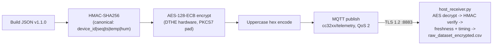

# Week 10 -- Integration with CpE-1 Secure Firmware

This document is the Spring 2026 Week 10 deliverable for the CpE-2 stream:
**integration notes for the merged CpE-1 + CpE-2 secure firmware**.  It
captures the design decisions, the interface mismatches that had to be
resolved, the resulting wire format, and the end-to-end demo procedure
used to verify encryption, integrity, and timing across the full pipeline.

The merged source lives in
[`Sp2026-CpE2/merged_project/`](..) and replaces the standalone
[`mqtt_client_CC3220SF_LAUNCHXL_freertos_ticlang/`](../../mqtt_client_CC3220SF_LAUNCHXL_freertos_ticlang)
project for the rest of the semester.

## 1. Goals (from the project plan)

> Week 10: Integration with Secure Firmware (CpE-1)
>
> Goal: Validate end-to-end secure pipeline.
>
> Tasks: Integrate with CpE-1 secure firmware -- Verify encryption,
> integrity, and timing end-to-end -- Resolve interface mismatches.
>
> Deliverables: End-to-end secure streaming demo -- Integration notes.

## 2. What was already aligned vs what had to change

Before any code was touched, both halves of the project shared three
interfaces by design:

| Layer                | CpE-1 firmware                                           | CpE-2 firmware (pre-merge)                              | Status      |
|----------------------|----------------------------------------------------------|----------------------------------------------------------|-------------|
| HMAC PSK             | 32-byte `MySecureDigitalTwinKey2026!@#$%^` in `hmac_auth.h` | Same 32-byte PSK in `hmac_auth.h`                       | Identical   |
| HMAC canonical       | `device_id\|seq_num\|timestamp_ms\|temperature_c\|humidity` | `device_id\|seq_num\|timestamp_ms\|temperature_c\|humidity` | Identical |
| Device id            | `CC3220SF_NODE_01`                                       | `CC3220SF_NODE_01`                                       | Identical   |
| Schema header fields | `schema_version` / `device_id` / `seq_num` / `timestamp_ms` | Same                                                    | Identical   |

The interfaces that **did not match** and had to be reconciled:

| Mismatch                            | CpE-1 design                                                            | CpE-2 design                                       | Resolution (Week 10)                                                                                                              |
|-------------------------------------|-------------------------------------------------------------------------|----------------------------------------------------|------------------------------------------------------------------------------------------------------------------------------------|
| Transport                           | UART2 only, `[AES] <hex>` prefix                                        | MQTT/TLS only, plaintext JSON                      | Single transport: firmware publishes raw uppercase hex ciphertext over MQTT/TLS only.  UART2 retained for board console + future UART-protocol sensors -- no telemetry. |
| Payload encryption                  | AES-128-ECB inside firmware (DTHE hardware)                             | None (TLS terminates at broker, broker sees JSON)  | Adopt AES-128-ECB inside the MQTT payload -- defense-in-depth so the broker host process never sees plaintext telemetry even if the TLS session is replaced by a `mosquitto_pub` injection. |
| Schema telemetry fields             | `temperature_c`, `humidity`, `pwm_duty_us`, `pwm_period_us`             | `temperature_c`, `humidity` only                   | Bump schema to **v1.1.0**; PWM fields added as **optional** members of `telemetry`.  `host_receiver.py` accepts both versions.    |
| HMAC canonical (PWM coverage)       | Excluded                                                                | Excluded                                           | Keep excluded; v1.0.0 HMAC contract is preserved verbatim.                                                                         |
| Publish rate                        | 3000 ms per packet                                                      | 250 ms per packet (4 Hz)                           | Standardize on 3000 ms.  The host-side timing monitor is already a rolling-window z-score and adapts.                              |
| PWM motor pin (`boosterpack.9/10`)  | Claimed by `CONFIG_PWM_0`                                               | Claimed by `CONFIG_GPIO_LED_1` / `CONFIG_GPIO_LED_2` | Drop the LED_1 / LED_2 GPIO instances; reassign the pins to PWM_0 in [`mqtt_client.syscfg`](../mqtt_client.syscfg).                |
| Fault injection                     | CORRUPT / DROP / DELAY in firmware                                      | None                                               | Adopt CpE-1 cadence (every 10 / 15 / 20) inside the publish loop.  Used to drive the Week 10 demo.                                 |
| MQTT topics for LED toggle          | n/a                                                                     | `cc32xx/ToggleLED1`, `LED2`, `LED3` subscriptions  | Removed (LED_1 / LED_2 no longer exist); a single `cc32xx/ToggleLED0` topic remains as a UI hook.                                  |

## 3. Final wire format



Every MQTT publish is raw uppercase hex ciphertext.  The broker
discriminates plaintext JSON (test harnesses, legacy v1.0.0 firmware)
from ciphertext by leading character: `{` -> JSON, hex digit -> AES.

Inner JSON (v1.1.0):

```json
{
  "schema_version": "1.1.0",
  "device_id": "CC3220SF_NODE_01",
  "seq_num": 4271,
  "timestamp_ms": 12813000,
  "telemetry": {
    "temperature_c": 25.1,
    "humidity": 47.8,
    "pwm_duty_us": 9000,
    "pwm_period_us": 10000
  },
  "hmac": "bf1ce0c1...64 hex characters..."
}
```

HMAC canonical string (unchanged from v1.0.0):

```
CC3220SF_NODE_01|4271|12813000|25.1|47.8
```

PWM fields are **deliberately excluded** from the HMAC so that v1.0.0
receivers continue to validate v1.1.0 packets without coordination.

## 4. SysConfig changes ([mqtt_client.syscfg](../mqtt_client.syscfg))

| Module instance      | v1.0.0 (pre-merge)                              | v1.1.0 (post-merge)                              |
|----------------------|-------------------------------------------------|--------------------------------------------------|
| `Crypto1`            | Present (`CONFIG_Crypto_0`)                     | Present (used by AES path now)                   |
| `GPIO3`              | `CONFIG_GPIO_LED_0` (LED0, status)              | Same                                             |
| `GPIO4`              | `CONFIG_GPIO_LED_1` (LED2, boosterpack.9)       | **Removed**                                      |
| `GPIO5`              | `CONFIG_GPIO_LED_2` (LED1, boosterpack.10)      | **Removed**                                      |
| `PWM1`               | n/a                                             | **Added** -- `CONFIG_PWM_0`, LED_YELLOW, boosterpack.9 (Timer3) |

Pin reassignment table:

| Pin             | v1.0.0 owner             | v1.1.0 owner       |
|------------------|--------------------------|--------------------|
| `boosterpack.9`  | `CONFIG_GPIO_LED_1`      | `CONFIG_PWM_0`     |
| `boosterpack.10` | `CONFIG_GPIO_LED_2`      | (free)             |
| `boosterpack.29` | `CONFIG_GPIO_LED_0`      | `CONFIG_GPIO_LED_0` (unchanged) |

## 5. Firmware changes ([mqtt_client_app.c](../mqtt_client_app.c))

The merge-related changes are scoped to the publish loop and a small
amount of init code.  Key landmarks:

- Includes: `<ti/drivers/PWM.h>` and `<ti/drivers/crypto/CryptoCC32XX.h>`.
- New constants: `SCHEMA_VERSION "1.1.0"`, `MOTOR_PERIOD_US 10000`,
  `AES_BLOCK_SIZE 16`, `FAULT_DROP_EVERY 15`, `FAULT_CORRUPT_EVERY 10`,
  `FAULT_DELAY_EVERY 20`, `AES_KEY[16]` = `"LabKey12LabKey12"`.
- File-scope scratch buffers: `s_canonical[192]`, `s_jsonPayload[384]`,
  `s_padded[512]`, `s_cipher[512]`, `s_outbuf[1200]`.
- Helpers (lifted from CpE-1 `pwmled2.c`): `pkcs7_pad()`,
  `aes_encrypt_hex()`.
- Init in `mainThread()`: `PWM_init()` + `CryptoCC32XX_init()`,
  `g_cryptoHandle = CryptoCC32XX_open(CONFIG_Crypto_0, CryptoCC32XX_AES)`,
  `PWM_open(CONFIG_PWM_0, ...)` + `PWM_start()`.
- `buildTelemetryPayload()` now takes the current PWM duty/period and
  emits v1.1.0 JSON.  It returns a `FAULT_NONE / FAULT_CORRUPT /
  FAULT_DROP` code so the publish loop can act on it.
- The `APP_MQTT_PUBLISH` branch:
  1. Step the motor: `PWM_setDuty(g_motorPwm, g_duties[g_dutyIdx])`.
  2. Read sensor (`DHT11_Read`).
  3. Build JSON + HMAC + apply CORRUPT or DROP fault.
  4. AES-encrypt + hex-encode.
  5. Publish hex ciphertext on `cc32xx/telemetry` over MQTT/TLS.
  6. Apply DELAY fault (extra 2 s sleep).
  7. Advance duty index, sleep 3 s, re-enqueue self.

## 6. Host changes

### [`broker/host_receiver.py`](../broker/host_receiver.py)

- Imports `pycryptodome` (`Crypto.Cipher.AES`, `Crypto.Util.Padding.unpad`).
- New constant `AES_KEY = b"LabKey12LabKey12"`.
- `SUPPORTED_SCHEMA_VERSIONS = {"1.0.0", "1.1.0"}`.
- New helper `decrypt_aes_payload()` -- takes a hex ciphertext string
  and returns the inner JSON, or `None` on `bytes.fromhex` / AES decrypt
  / PKCS7 unpad failure.
- `on_message()` discriminates plaintext from ciphertext by leading
  character: stripped payload starts with `{` -> JSON path (legacy
  v1.0.0 firmware, test_*.py harnesses); otherwise -> AES hex path
  (decrypt first, then JSON parse).  No prefix tag is needed because
  every production publish is ciphertext.
- `aes_fail` counter and `[AES FAIL]` console tag for ciphertext that
  fails to decrypt -- this is exactly how the firmware CORRUPT fault is
  detected when it happens to flip a byte that lands in ciphertext
  (vs. before-HMAC plaintext).
- CSV header gets two new columns: `PWM_Duty_us`, `PWM_Period_us`.
- `_log_csv()` accepts the two new fields and writes them per row.
- Ctrl+C summary now prints `AES Decrypt Failed:`.

### Digital-twin feed

There is no separate UART-side adapter in the merged pipeline.  The ME
team's digital twin reads `raw_dataset_encrypted.csv` directly --
that file is the single canonical sink for every accepted packet and
already carries `Schema_Version`, `Device_ID`, `Seq_Num`, `Board_Time_ms`,
`Temp_C`, `Humidity_%`, `HMAC_Verified`, `Freshness_Status`,
`Host_Delta_ms`, `PWM_Duty_us`, `PWM_Period_us` per row (header in
[`broker/host_receiver.py`](../broker/host_receiver.py) lines 74-78).
The peer's CpE-1 `uart_to_twin.py` was a bench tool for the dual-
transport prototype and is no longer part of the merged pipeline.

### Test helpers

[`test_integrity.py`](../broker/test_integrity.py),
[`test_freshness.py`](../broker/test_freshness.py),
[`test_schema.py`](../broker/test_schema.py) gained an `aes_wrap()`
helper that produces real AES-128-ECB ciphertext lines.  New tests:

- `test_integrity.py` Test 5 -- end-to-end AES wire-format roundtrip
  (encrypt, hex-encode, decrypt, verify HMAC).
- `test_schema.py` Test 3b -- v1.1.0 packet acceptance and confirmation
  that PWM fields are excluded from the HMAC.
- `test_schema.py` Test 5 -- AES-wrapped v1.1.0 broker roundtrip.

## 7. End-to-end secure streaming demo

The demo proves the three Week 10 verification axes (encryption,
integrity, timing) by running the full pipeline against the merged
firmware while fault injection deliberately exercises each failure mode.

### Setup

```bash
# Terminal 1: broker
cd Sp2026-CpE2/merged_project/broker
./broker.sh                    # mosquitto with TLS 1.2 on :8883

# Terminal 2: MQTT host receiver (also writes raw_dataset_encrypted.csv
#             which the ME team's digital twin consumes directly)
cd Sp2026-CpE2/merged_project/broker
python3 host_receiver.py       # subscribes to cc32xx/telemetry

# Flash the merged firmware via SimpleLink Image Creator (UniFlash)
# using the secure-boot certificate chain documented in
# docs/crypto_configuration.md (Week 5 procedure).
# Set SOP2 jumper for flash mode, build, remove jumper, power cycle.

# Press SW2 (BTN0) on the LaunchXL to start publishing.
```

### What you will see (steady state)

- Motor cycles 70 -> 80 -> 90 -> 100% duty every 3 s (audible and visible
  on the boosterpack.9 LED).
- Host receiver prints `[ACCEPTED]` rows for the majority of packets.
- Every 10th packet (`seq % 10 == 0`):
  `[FAULT] CORRUPT seq=N` on the firmware debug UART, followed by
  `[HMAC FAIL: mismatch]` on the host receiver.  The packet is logged
  with `HMAC_Verified=False` in `raw_dataset_encrypted.csv`.
- Every 15th packet (`seq % 15 == 0`):
  `[FAULT] DROP seq=N` on the firmware debug UART, no MQTT publish.
  Host receiver prints `[OOO_GAP]` warning (`packets_lost` counter
  increments).
- Every 20th packet (`seq % 20 == 0`):
  `[FAULT] DELAY seq=N`, an extra 2 s sleep.  Host receiver flags
  `[TIMING ALERT z=...]`; `timing_features.csv` row has `Timing_Anomaly=True`.

### Ctrl+C summary (typical, after ~2 min)

```
--- Performance & Integrity Summary ---
Packets Received:     ~38
Packets Accepted:     ~32
Packets Lost (gaps):  ~2

--- Authentication ---
HMAC Verified (pass): ~32
HMAC Failed:          ~4
AES Decrypt Failed:   0     (or non-zero if CORRUPT happens to corrupt ciphertext)

--- Freshness & Replay ---
Replays Detected:     0
Stale Packets:        0
Out-of-Order/Gaps:    ~2

--- Timing Analysis ---
Timing Anomalies:     ~2
```

## 8. Verification matrix

| Requirement (from project plan) | How verified                                                                                                  | Evidence                                                                  |
|---------------------------------|---------------------------------------------------------------------------------------------------------------|---------------------------------------------------------------------------|
| Encryption end-to-end           | Broker logs / `mosquitto_sub` show only uppercase hex ciphertext payloads; `host_receiver.py` decrypt path runs cleanly. | `aes_fail = 0` for normal packets, hex ciphertext visible in mqtt console.|
| Integrity end-to-end            | Firmware CORRUPT fault flips canonical bytes -> HMAC mismatches at host.  Forged `mosquitto_pub` rejected.    | `[HMAC FAIL: mismatch]` rows, `HMAC_Verified=False` in CSV every 10th seq.|
| Timing end-to-end               | Firmware DELAY fault adds 2 s -> rolling z-score > 3 on host.                                                 | `[TIMING ALERT z=...]` rows, `Timing_Anomaly=True` in `timing_features.csv`. |
| Replay detection (carryover)    | `host_receiver.check_freshness()` rejects duplicate / out-of-order seq.                                       | `replays_detected`, `duplicates_detected` counters in summary.            |
| Schema versioning               | v1.0.0 and v1.1.0 both accepted; unknown versions rejected.                                                   | `test_schema.py` 3b + 5 pass.                                              |
| Digital-twin feed               | ME team consumes `raw_dataset_encrypted.csv` directly (no separate UART adapter).                              | CSV header includes `PWM_Duty_us` / `PWM_Period_us`; `HMAC_Verified=True` rows for accepted packets. |

## 9. Pending items / known limitations

| Item                              | Owner            | Notes                                                                                                                  |
|-----------------------------------|------------------|------------------------------------------------------------------------------------------------------------------------|
| AES-ECB -> AES-CBC/CTR            | Fall security    | ECB is acceptable for the research stage but CBC or CTR with a per-packet IV is the production target.                  |
| AES + HMAC key provisioning       | Fall security    | Both keys are still hardcoded (firmware + host).  Move to CC3220SF secure file system + per-device derivation.         |
| HX711 load cell                   | Fall EE          | Not present.  When added, schema will bump to v1.2.0 with `load_cell_g` optional field.                                 |
| Real DHT11 temp/humidity          | Fall EE          | Currently `rand()`-based simulation in `DHT11_Read()`.  Replace with GPIO bit-bang once the part is wired.              |
| Firmware fault injection toggle   | CpE-2            | Currently always-on for the demo.  Wrap behind an `#ifdef FAULT_INJECTION` for production builds.                       |
| Anti-rollback / signed updates    | CpE-1            | Secure boot certificate chain is still TI dummy certs.  Production deployment must replace and burn root CA to OTP.    |
