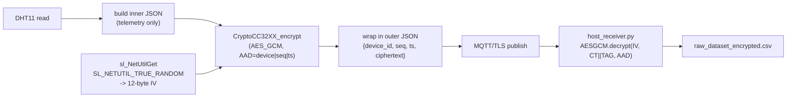

# Week 11 -- AES-128-GCM (AEAD) Upgrade

This document is the Spring 2026 Week 11 deliverable: the migration
from the Week 10 AES-128-ECB + inner HMAC-SHA256 stack to a single
hardware-accelerated AES-128-GCM (AEAD) layer on the CC3220SF DTHE
crypto engine.  Schema bumps from `v1.1.0` to `v2.0.0`.

## 1. Why GCM

ECB is structurally insecure -- it leaks plaintext patterns at the
16-byte block boundary because identical plaintext blocks always
produce identical ciphertext.  CBC fixes that, but only with a careful
choice of IV and padding, and CBC alone provides no integrity --
historically that was bolted on with HMAC-then-encrypt or
encrypt-then-HMAC compositions, both of which are easy to get wrong.

GCM is an *authenticated encryption with associated data* (AEAD)
construction, standardized in NIST SP 800-38D.  Its hardware-accelerated
form on the CC3220SF gives:

- **Confidentiality** -- AES-CTR keystream over the plaintext.
- **Ciphertext integrity** -- 128-bit Galois/Counter MAC tag over the
  ciphertext.
- **Metadata authentication** -- the same 128-bit tag also covers any
  Additional Authenticated Data (AAD) the caller binds to the message,
  which lets us authenticate plaintext envelope fields like
  `device_id`, `seq_num`, and `timestamp_ms` without encrypting them.

In other words, a single GCM call replaces *both* the ECB encrypt and
the HMAC-SHA256 sign/verify of the v1.1.0 stack.  No padding is needed
(GCM is a stream cipher), and the single 16-byte tag is forgery-proof
(any tamper in IV, ciphertext, or AAD fails verification with
overwhelming probability).

## 2. Hardware support on the CC3220SF

The CC3220SF DTHE block exposes GCM through the SimpleLink driver:

```c
#include <ti/drivers/crypto/CryptoCC32XX.h>

CryptoCC32XX_init();
CryptoCC32XX_Handle h = CryptoCC32XX_open(CONFIG_Crypto_0,
                                          CryptoCC32XX_AES);

CryptoCC32XX_EncryptParams params = { 0 };
params.aes.keySize             = CryptoCC32XX_AES_KEY_SIZE_128BIT;
params.aes.pKey                = AES_KEY;
params.aes.pIV                 = iv;             /* 12 bytes */
params.aes.aadParams.input.len = aad_len;        /* AAD bytes */

CryptoCC32XX_encrypt(h, CryptoCC32XX_AES_GCM,
                     gcm_in, plain_len,          /* gcm_in = [AAD || PT] */
                     gcm_out, &cipher_len,
                     &params);
/* params.aes.aadParams.tag now holds the 16-byte authentication tag. */
```

Internally the SDK driver maps `CryptoCC32XX_AES_GCM` to the DTHE mode
`AES_CFG_MODE_GCM_HY0CALC` (auto-derived counter -- the H sub-key and
Y0 counter are computed by hardware), and calls `MAP_AESDataProcessAE`
with the AAD region prefixed at the front of the input buffer.  This
input-buffer convention is what `gcm_encrypt_envelope()` mirrors in
`mqtt_client_app.c`.

> Reference: SimpleLink CC32xx SDK 7.10
> [`source/ti/drivers/crypto/CryptoCC32XX.h`](file:///Applications/ti/simplelink_cc32xx_sdk_7_10_00_13/source/ti/drivers/crypto/CryptoCC32XX.h)
> and the corresponding `.c` driver implementation.

## 3. Wire format (schema v2.0.0)

Each MQTT publish on `cc32xx/telemetry` is a **plaintext outer JSON
envelope**:

```json
{
  "schema_version": "2.0.0",
  "device_id": "CC3220SF_NODE_01",
  "seq_num": 12345,
  "timestamp_ms": 67890,
  "ciphertext": "<UPPERCASE_HEX of (IV[12] || CT[N] || TAG[16])>"
}
```

The hex-encoded `ciphertext` field carries three concatenated blobs:

| Field | Length    | Notes                                        |
| ----- | --------- | -------------------------------------------- |
| IV    | 12 bytes  | 96-bit GCM nonce, fresh per publish (TRNG).  |
| CT    | N bytes   | AES-128-GCM ciphertext of the inner JSON.    |
| TAG   | 16 bytes  | GCM authentication tag, covers IV+CT+AAD.    |

The **inner plaintext JSON** that the firmware encrypts looks like:

```json
{
  "schema_version": "2.0.0",
  "telemetry": {
    "temperature_c": 25.3,
    "humidity": 48.7,
    "pwm_duty_us": 8000,
    "pwm_period_us": 10000
  }
}
```

Identity / replay metadata is intentionally *outside* the ciphertext
because the broker's freshness pipeline needs `seq_num` and
`timestamp_ms` *before* it has the AES key (cleanly separates
"who/when" from "what").  Those fields are bound to the GCM tag
through AAD, so they are still authenticated.

## 4. AAD canonical form

```
AAD = ASCII(f"{device_id}|{seq_num}|{timestamp_ms}")
```

This is the same first-three fields of the v1.1.0 HMAC canonical
string, byte-for-byte.  Both sides use a `snprintf("%s|%lu|%lu", ...)`
recipe so they always agree on integer-to-decimal formatting; if the
broker's `seq_num` ever differs from the firmware's by even one
character of ASCII representation, GCM verification fails on the host.

## 5. Nonce sourcing

Every publish uses a fresh 12-byte (96-bit) random nonce pulled from
the CC3220SF NWP True Random Number Generator:

```c
uint16_t len = 12;
sl_NetUtilGet(SL_NETUTIL_TRUE_RANDOM, 0, iv, &len);
```

`SL_NETUTIL_TRUE_RANDOM` is option `3` in
`source/ti/drivers/net/wifi/netutil.h`, sourced from the NWP hardware
TRNG, and is the same entropy source the SDK's
`mbedtls_hardware_poll()` uses to seed mbedTLS.  It requires the NWP to
be powered up, so `gcm_encrypt_envelope()` is only callable from the
publish thread after `WIFI_IF_init()` / `SlNetConn_start()` have run --
which is exactly the firmware's existing publish lifetime.

96-bit random nonces give a `2^96` per-key budget before collision
risk becomes meaningful.  At the lab demo's ~3 s publish cadence that
is roughly `~3 * 10^21` years; nonce reuse is not a practical concern.

## 6. Architecture flow



## 7. Failure modes the host catches

| Tamper                                        | What fails                          | Host log               | CSV `Freshness_Status` |
| --------------------------------------------- | ----------------------------------- | ---------------------- | ---------------------- |
| Outer envelope is not JSON                    | `json.loads` of envelope            | `[ENVELOPE FAIL]`      | (not logged)           |
| `schema_version` not in the supported set     | Schema check                        | `[SCHEMA UNKNOWN: ..]` | `SCHEMA_UNKNOWN`       |
| Outer `seq_num` / `timestamp_ms` modified     | GCM AAD mismatch                    | `[GCM FAIL]`           | `GCM_FAIL`             |
| Even one byte flipped in the hex `ciphertext` | GCM tag verify                      | `[GCM FAIL]`           | `GCM_FAIL`             |
| Wrong AES key                                 | GCM tag verify                      | `[GCM FAIL]`           | `GCM_FAIL`             |
| Inner JSON corrupted before encrypt (CORRUPT) | GCM passes, inner `json.loads` fails| `[JSON FAIL]`          | `INNER_PARSE_FAIL`     |
| Replay / duplicate / stale envelope           | Freshness check (still GCM-OK)      | `[GCM OK][REPLAY]` ... | `REPLAY` / `DUPLICATE` / `STALE` / `OOO_GAP` / `REBOOT_RESET` |

## 8. Test coverage

`broker/test_integrity.py` (Week 11 rewrite) exercises the AEAD
boundary directly:

1. Valid envelope decrypts and parses.
2. 1-byte hex flip in `ciphertext` -> `InvalidTag`.
3. Outer `seq_num` bumped (AAD tamper) -> `InvalidTag`.
4. Wrong key -> `InvalidTag`.
5. Missing `ciphertext` field -> envelope rejected.
6. End-to-end Mosquitto roundtrip + GCM verify.

`broker/test_schema.py` validates the v2.0.0 outer envelope shape,
PWM telemetry survival inside the inner JSON, and broker relay.

`broker/test_freshness.py` continues to exercise replay / duplicate /
out-of-order / reboot / stale logic, but every published payload is
now a real v2.0.0 GCM-authenticated envelope.

## 9. Future work

- **Per-device keys** -- both `AES_KEY` and the AAD `device_id` are
  hardcoded for the lab demo.  The CC3220SF secure file system can
  hold a per-device key derived from a master secret, indexed by
  `device_id`, with key rotation support.
- **Promote to AES-256** -- one-line firmware change
  (`CryptoCC32XX_AES_KEY_SIZE_256BIT` plus a 32-byte `AES_KEY`).
  No wire-format change; the GCM IV/tag lengths stay at 12/16 bytes.
- **Integrate with TLS-PSK** -- with AEAD already in place at the
  payload layer, the MQTT/TLS layer could move to PSK ciphersuites and
  drop the certificate machinery.  Out of scope for this semester.
